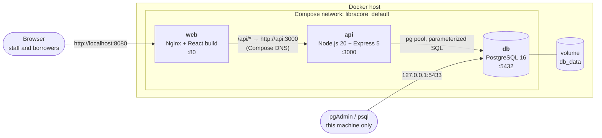
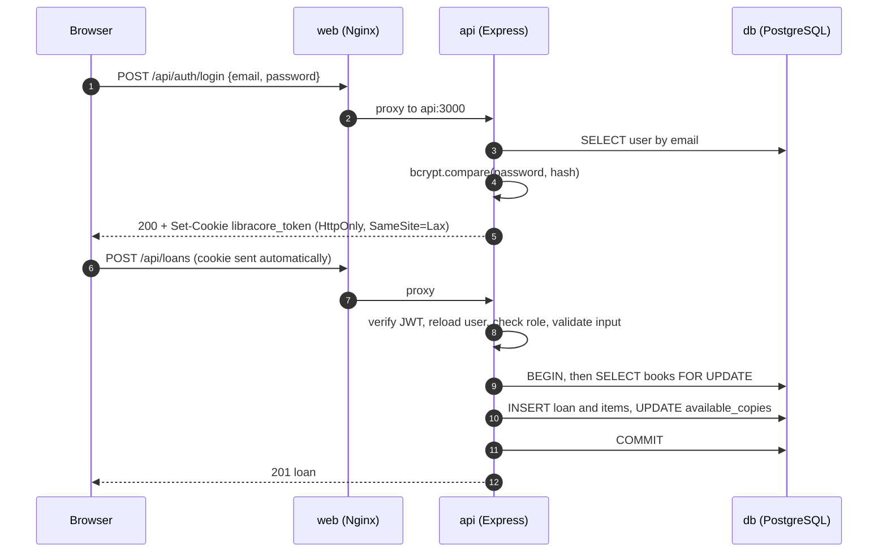
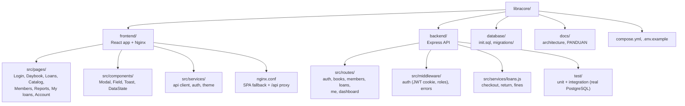
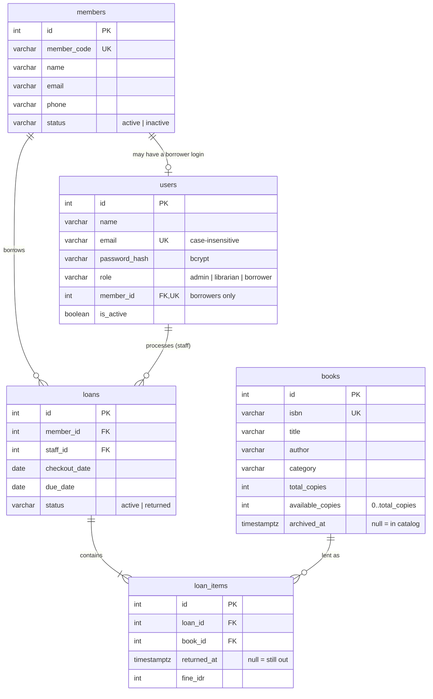

# LibraCore architecture

## Services



| Service | Image | Published port | Health check |
|---|---|---|---|
| `web` | `libracore-web` (multi-stage: Node build → `nginx:1.27-alpine`) | `8080 → 80` | `wget http://127.0.0.1/` |
| `api` | `libracore-api` (`node:20-alpine`, runs as `node` user) | none | `wget http://127.0.0.1:3000/api/health` (checks DB) |
| `db` | `postgres:16-alpine` | `127.0.0.1:5433 → 5432` (localhost only, for pgAdmin) | `pg_isready` |

Start-up order is enforced with `depends_on: condition: service_healthy`:
`db` healthy → `api` starts (and bootstraps the first admin) → `api` healthy → `web` starts.

## Request flow



1. The browser loads the React app from Nginx.
2. The app calls `/api/...` on the same origin, so the `HttpOnly` session cookie is sent automatically.
3. Nginx forwards `/api/` to the `api` service by its Compose service name.
4. Express authenticates the cookie (JWT, HS256), reloads the user from the database, checks the role, validates input and runs parameterized SQL.
5. Checkout and return run inside transactions with `SELECT ... FOR UPDATE` row locks.

## Project structure



```text
libracore/
├── frontend/
│   ├── public/                 index.html (theme bootstrap), favicon
│   ├── src/
│   │   ├── components/         Modal, Field, ConfirmDialog, DataState, Toast, Icon
│   │   ├── layouts/            AppLayout (masthead + navigation per role)
│   │   ├── pages/              one file per screen
│   │   ├── services/           api.js, auth.js, theme.js, format.js, useResource.js
│   │   ├── App.js              routes per role
│   │   └── styles.css          design tokens, light and dark themes
│   ├── nginx.conf
│   └── Dockerfile              multi-stage: node build → nginx
├── backend/
│   ├── src/
│   │   ├── middleware/         auth.js, errors.js
│   │   ├── routes/             auth, books, members, loans, me, dashboard
│   │   ├── services/loans.js
│   │   ├── app.js  config.js  db.js  bootstrap.js  validation.js  errors.js
│   │   └── server.js
│   ├── test/                   unit.test.js, api.test.js, helpers.js
│   └── Dockerfile
├── database/
│   ├── init.sql                schema + sample data (fresh volumes)
│   └── migrations/             changes for existing databases
├── docs/                       architecture.md, PANDUAN.md
├── compose.yml
├── .env.example
└── README.md
```

## Backend layout

| Path | Responsibility |
|---|---|
| `src/server.js` | Entry point: config, DB wait, admin and demo-borrower bootstrap, graceful shutdown |
| `src/app.js` | Express app: security headers, JSON parsing, request log, routes, error handler |
| `src/config.js` | Reads and validates environment variables |
| `src/db.js` | Connection pool and `withTransaction` helper |
| `src/middleware/auth.js` | Cookie authentication and role checks |
| `src/middleware/errors.js` | 404 and error mapping (no stack traces to clients) |
| `src/routes/*.js` | REST endpoints (`me.js` is the borrower's own data) |
| `src/services/loans.js` | Checkout, return and late-fee rules |
| `src/validation.js` | Input validation helpers |

## Access control

Access is enforced in the API by role. Borrowers have per-user data, which is isolated by member: `/api/me/*` queries always filter on `req.user.memberId`, taken from the authenticated session (never from the request), so one borrower cannot read another's loans.

| Action | Borrower | Librarian | Admin |
|---|---|---|---|
| Browse the catalog | ✔ (read-only) | ✔ | ✔ |
| Own card, loans and fees (`/api/me/*`) | ✔ own only | ✘ (403) | ✘ (403) |
| Dashboard, members, all loans | ✘ (403) | ✔ | ✔ |
| Create/edit books and members, check out, return | ✘ (403) | ✔ | ✔ |
| Give/remove borrower sign-in | ✘ (403) | ✔ | ✔ |
| Archive a book, delete a member, reports | ✘ (403) | ✘ (403) | ✔ |

The integration tests (`backend/test/api.test.js`) verify these rules, including two borrowers who each see only their own loans.

## Data model



Integrity rules enforced by the database: `available_copies` between 0 and `total_copies`, unique ISBN, unique member code, unique staff email (case-insensitive), a book appears at most once per loan, and `due_date >= checkout_date`.

## Cloud deployment plan

The same images can run on a single VPS with Docker Compose (e.g. a small cloud VM) behind a TLS-terminating reverse proxy, with `COOKIE_SECURE=true`. For a managed setup, run `api` and `web` on a container service and replace the `db` container with a managed PostgreSQL instance with automated backups; only the `DB_*` variables change.
